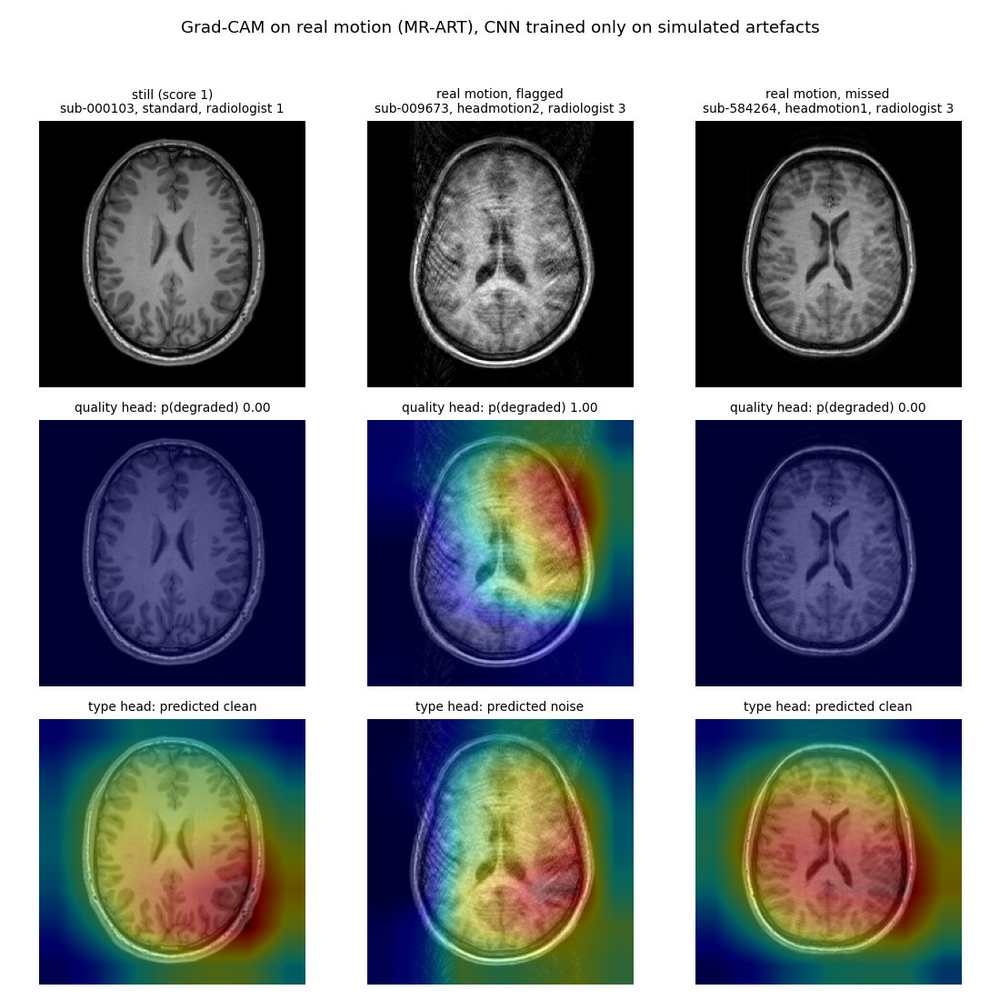

# Automated MRI Image Quality Assessment

**Can a CNN trained only on physics-based *simulated* artefacts detect real
artefacts in brain MRI, and does it beat classical image-quality metrics?**

Motion, noise and blur can make a brain MRI scan unusable. Catching a bad scan
while the patient is still in the scanner saves a recall visit, and it stops
corrupted images from misleading radiologists or downstream AI models. This
project simulates artefacts on clean scans ([IXI](https://brain-development.org/ixi-dataset/), 578 subjects, 3 scanners),
trains a classical baseline and a multi-task CNN, then tests both on **real
patient motion** ([MR-ART](https://openneuro.org/datasets/ds004173), 148 people, 436 scans scored by a neuroradiologist)
without any retraining.

## Summary

| Test | Classical features + random forest | Multi-task CNN |
|---|---|---|
| Simulated artefacts, scanners seen in training (AUROC / type F1) | 0.995 / 0.962 | **0.999 / 0.999** |
| Simulated artefacts, **unseen scanner** (AUROC / type F1) | 0.927 / 0.638 | **0.986 / 0.870** |
| **Real motion**, unseen vendor (AUROC vs. radiologist, score ≥ 2) | 0.885 | 0.886 |
| Real motion: one person's 3 scans ordered like the radiologist | 0.949 | **0.974** |
| Real motion called *motion* by the type head | 0 % | 0 % |

1. **On simulated data the CNN is near perfect, and it generalises to an unseen
   scanner far better than hand-crafted features.** The classical model mistakes
   the smoother GE images for blur or motion; the CNN mostly does not.
2. **Both models' probabilities shift on a new scanner.** A threshold set from
   just 3 clean scans of the new site recovers most of the loss (CNN balanced
   accuracy 0.73 → 0.84), so deployment needs per-site calibration, not
   retraining.
3. **On real motion, ranking transfers but the CNN's advantage disappears.**
   Both models rank real scans well (AUROC 0.89; unusable scans 0.94), but
   neither beats a single standard MRIQC metric (`snr_total`, 0.92), and both
   are badly miscalibrated.
4. **The likely main reason is physical, and fixable** (to be confirmed by
   re-simulating; see *Limitations and next steps*). Real motion ghosts run
   anterior-posterior, the phase-encoding direction of the MPRAGE scans; my
   simulator moved the head between segments of the left-right axis, so its
   ghosts run left-right. The ghost-direction feature has the opposite sign
   (+0.40 simulated, −1.07 real). The model never sees ghosts along the right
   axis, so it calls real motion *noise*. Grad-CAM shows the same thing: on real
   motion the CNN's evidence is not concentrated on the head.


## Design

| Choice | Why |
|---|---|
| IXI T1-weighted brain MRI, 2D axial slices | Clean, multi-site (3 scanners, 1.5T and 3T), freely licensed; 2D keeps compute small |
| Artefacts simulated with physics in mind | Rigid motion in **3D k-space**, **Rician** noise (not Gaussian), blur |
| Multi-task output | Good/degraded + artefact type + continuous severity |
| Classical baseline | Laplacian variance, SNR, entropy + random forest; the CNN has to beat it |
| **Subject-level** splits, stratified by site | Slices from one brain never appear in two splits (no leakage) |
| Real-artefact test set (MR-ART) | Measures the gap between synthetic training and real artefacts |

## Plan

| Stage | Work | Status |
|---|---|---|
| 1 | Download and explore IXI T1; orientation, spacing, slice selection; subject splits | done (581 subjects) |
| 2 | Preprocess slices; artefact simulation (k-space motion, Rician noise, blur) | done |
| 3 | Labels: type and severity per slice; SSIM/PSNR vs. clean reference | done |
| 4 | Classical baseline, then a multi-task CNN | done |
| 5 | Evaluation: per-artefact and per-severity, per-site, real-artefact test (MR-ART) | done |
| 6 | Grad-CAM, figures, write-up | done |

## Setup

```bash
python -m venv .venv
.venv\Scripts\activate          # Windows  (Linux/macOS: source .venv/bin/activate)
pip install -e ".[dev]"
# CNN stage only: GPU build of PyTorch (CUDA 11.8 wheels work on driver >= 452)
pip install torch==2.5.1 torchvision==0.20.1 --index-url https://download.pytorch.org/whl/cu118
pytest                          # runs on synthetic volumes; no download needed
```

## Stage 1: data

```bash
# all 581 T1 volumes (4.8 GB); add --max-subjects 50 for a quick first look
python scripts/download_ixi.py
python scripts/explore_ixi.py
```

`explore_ixi.py` writes `outputs/exploration/volume_summary.csv`, three figures
(orthogonal views per site, axial slice selection, intensity histograms by site,
plus `fig_slice_range_qc.png`, the kept slice range for 16 subjects)
and `data/splits.json`.

### Stage 1 findings

- **Acquisition is sagittal 3D.** Every volume is stored `PSR`, with 130–150
  sagittal partitions at 1.2 mm and 256 × 256 in-plane at 0.94 mm. Axial slices
  are therefore anisotropic (1.2 × 0.94 mm) and must be resampled before training.
  Motion happens during the 3D acquisition, so motion artefacts should be
  simulated in **3D k-space** and the axial slices taken afterwards.
- **The field of view includes the neck.** Head coverage alone selects neck and
  face slices, so slices are picked by distance below the top of the head
  (20–85 mm). That gives 71 slices per volume, from the basal ganglia up to the
  upper cerebrum. Head tilt is not corrected (that would need registration), so
  a few subjects' lowest slices include the orbits.
- **Intensities differ by scanner.** Even after percentile normalisation, the
  IOP (GE) scans have visibly different contrast from Guys and HH (Philips).
  This shift between sites is worth reporting per site at evaluation.
- **Sites are unbalanced:** 322 Guys, 185 HH, 74 IOP. Splits are stratified by
  site (train 407 / val 87 / test 87 subjects). The first 50 subjects in the
  archive are almost all Guys and HH (1 IOP), so a partial download is not
  representative.
- **3 subjects are excluded** (IXI085, IXI292, IXI424): the top of the head is
  outside the field of view, so the slice range cannot be anchored.

## Stages 2–3: artefacts and labels

```bash
python scripts/make_artefact_gallery.py      # fig_gallery.png, fig_motion_kspace.png
python scripts/calibrate_severity.py         # severity check on a few subjects
python scripts/build_dataset.py --workers 6  # full dataset (~2.7 h on 6 CPU cores, 3.4 GB)
```


**Pipeline per subject.** Reorient to RAS, resample to 1 mm isotropic, mask the
head, normalise to the 0.5–99.5 % foreground percentiles. Each artefact is applied
to the **whole 3D volume**, then the degraded volume is re-normalised with the
clean head mask (as a real scan would be), so intensity range cannot be used as a
shortcut. Every 2nd axial slice 20–85 mm below the vertex is kept (33 per subject)
and cut with one fixed 224 × 224 mm window per subject.

| Artefact | Model | Level 1 / 2 / 3 |
|---|---|---|
| Noise | Rician: magnitude of signal + complex Gaussian noise | σ = 0.02 / 0.04 / 0.08 |
| Blur | Gaussian | σ = 0.6 / 1.0 / 1.6 mm |
| Motion | Rigid moves during a sequential 3D k-space acquisition (slow axis L-R); the pose at the k-space centre is the reference, moved poses fill the other segments | 2 moves ≤ 1.5 mm/° / 2 moves ≤ 3 mm/° / 4 moves ≤ 5 mm/°, closer to the k-space centre at higher levels |

Each subject gets all three artefacts, with levels cycled across subjects, so
every (artefact, level) pair is equally common. Seeds derive from
(seed, subject, artefact), so any subject can be regenerated on its own.

**Labels per slice** (`data/processed/slices.csv`): artefact type, nominal level,
and SSIM / PSNR against the clean slice, **computed inside the head only**
(whole-slice metrics are dominated by background air).

Masked SSIM over 578 subjects (76,296 slices incl. clean), mean [5th–95th percentile]:

| Artefact | Level 1 | Level 2 | Level 3 |
|---|---|---|---|
| Blur | 0.980 [0.969–0.989] | 0.913 [0.861–0.951] | 0.777 [0.658–0.865] |
| Noise | 0.950 [0.905–0.976] | 0.857 [0.746–0.920] | 0.669 [0.502–0.774] |
| Motion | 0.983 [0.958–0.997] | 0.967 [0.906–0.997] | 0.821 [0.532–0.986] |

### Stage 2–3 findings

- **Motion severity is stochastic.** The damage depends on *when* in k-space
  the head moves, not only how far, so nominal motion levels overlap (L1 and L2
  share most of their range, and some L3 volumes are nearly clean). The nominal
  level is a property of the simulation, not of the image. Severity targets for
  training should therefore come from the measured SSIM of each slice, not from
  the nominal level.
- **The same noise hurts some scanners more.** Mean SSIM under noise is
  0.85 (Guys), 0.83 (HH) and **0.72 (IOP)**: IOP images have lower normalised
  tissue contrast, so the same σ is a larger fraction of the signal. Severity is
  defined relative to the image, which is also how a radiologist would judge it.
- **Single movements are often invisible.** A move that lands in the outer
  k-space barely changes the image (SSIM ≈ 0.999), so level 1 uses two small
  moves to make it reliably visible.

## Stage 4a: classical baseline

```bash
python scripts/baseline_classical.py --workers 10   # ~5 min; features cached in outputs/baseline/
```

15 hand-crafted **no-reference** features per slice (`src/mriqa/features.py`),
each aimed at one mechanism: sharpness (Laplacian variance, gradients,
high-frequency energy) for blur; background statistics, residual-noise MAD and
SNR for noise; signal beside the head along the phase-encode axis and spectral
anisotropy for motion ghosting. The head mask is re-estimated from the slice
itself (Dice 0.99 vs. the clean-scan mask), so no reference information leaks in.
Three random forests (300 trees) predict quality (degraded = SSIM < 0.95),
artefact type, and severity (1 − SSIM). The same metric code
(`src/mriqa/evaluation.py`) will score the CNN.

| | Test (seen scanners) | **Unseen scanner** (train Guys + HH, test all IOP) |
|---|---|---|
| Quality AUROC | 0.995 | 0.927 |
| Quality balanced accuracy | 0.964 | 0.783 |
| Specificity (clean slices kept) | 0.964 | **0.584** |
| Type macro-F1 | 0.962 | 0.638 |
| Severity MAE (SSIM units) | 0.014 | 0.076 |
| Severity Spearman ρ | 0.962 | 0.790 |

Best single feature alone (one threshold, test AUROC): 0.76.

### Stage 4a findings

- **On scanners it has seen, the classical baseline nearly solves the synthetic
  task.** Hand-crafted features plus a random forest reach AUROC 0.995, while any
  single feature reaches only 0.76: the combination matters, not one metric.
  A CNN therefore cannot be judged on this split alone; there is little room left.
- **It breaks on a new scanner.** Trained without IOP (GE), it labels only 7.5 %
  of clean IOP slices as clean: 40 % are called blurred and 52 % motion-corrupted.
  The features measure absolute sharpness and texture, and the GE images are
  natively smoother, so "a different scanner" looks like "an artefact".
  The unseen-site split is the main benchmark for the CNN.
- **Noise is easy for a dataset-specific reason.** IXI backgrounds are already
  mostly exact zeros in the raw files (74 % for IXI002), so any noise filling the
  background is trivially visible. Scanners that do not mask the background would
  not give this cue; a real-artefact test set is needed to check it.
- **Weak motion is the hardest case,** even on seen scanners: 91 % of motion L1
  slices are correctly typed, yet only 7 % are truly degraded by the SSIM
  threshold.

## Stage 4b: multi-task CNN

```bash
python scripts/pack_slices.py                       # once: all slices in one 7.6 GB memory-mapped array
python scripts/train_cnn.py --experiment standard     # ~2.5 h on an RTX 3050 Ti laptop GPU
python scripts/train_cnn.py --experiment unseen_site  # train without IOP, test on all IOP subjects
python scripts/compare_models.py
python scripts/site_calibration.py
```

**Model** (`src/mriqa/cnn.py`). ResNet-18 with one input channel, trained from
scratch, with three heads on a shared encoder: quality (degraded or not), artefact
type, and severity (1 − SSIM). Loss = BCE + cross-entropy + 10 × smooth-L1.
AdamW with a one-cycle schedule, 12 epochs, batch 64, mixed precision; the
epoch with the lowest validation loss is kept. **Augmentation never creates or
removes artefacts**, because the labels describe the stored image: flips, integer
shifts (interpolation would blur) and monotonic intensity changes (gamma 0.7–1.4,
contrast ±15 %) that imitate differences between scanners. Test-time left-right
flip averaging.


| | Seen scanners: RF | Seen scanners: **CNN** | Unseen scanner: RF | Unseen scanner: **CNN** |
|---|---|---|---|---|
| Quality AUROC | 0.995 | **0.999** | 0.927 | **0.986** |
| Quality balanced accuracy (threshold 0.5) | 0.964 | **0.982** | **0.783** | 0.732 |
| Specificity | 0.964 | **0.986** | **0.584** | 0.466 |
| Type macro-F1 | 0.962 | **0.999** | 0.638 | **0.870** |
| Severity MAE (SSIM) | 0.014 | **0.007** | 0.076 | **0.070** |
| Severity Spearman ρ | 0.962 | **0.988** | 0.790 | **0.886** |

**Calibrating the threshold with a few clean scans from the new scanner**
(`site_calibration.py`): the threshold is set to the 95th percentile of
p(degraded) on clean slices from *k* IOP subjects, and the other IOP subjects
are evaluated (200 random draws per *k*).

| Clean IOP scans used | RF balanced accuracy | CNN balanced accuracy | CNN sensitivity |
|---|---|---|---|
| 0 (threshold 0.5) | 0.783 | 0.732 | 0.998 |
| 3 | 0.819 ± 0.046 | **0.842 ± 0.062** | 0.992 |
| 5 | 0.830 ± 0.037 | **0.863 ± 0.044** | 0.991 |
| 10 | 0.846 ± 0.021 | **0.873 ± 0.032** | 0.991 |

### Stage 4b findings

- **On scanners it has seen, the CNN is close to perfect:** type macro-F1
  0.999, and it identifies even level-1 motion (median SSIM 0.99) in 100 % of
  slices, against 91 % for the baseline. Severity error is half the baseline's.
- **On an unseen scanner, the CNN ranks much better but is miscalibrated.**
  AUROC 0.986 against 0.927, and type F1 0.87 against 0.64; it no longer confuses
  GE images with blur. But its probabilities shift upward: at the default
  threshold it flags 38 % of clean IOP slices as degraded, and its type head calls
  45 % of them *motion* (specificity over all acceptable slices: 0.47). It also
  over-predicts damage on clean IOP slices (mean predicted 1 − SSIM 0.058,
  true 0). So the scanner shift moves the scores, not just adds noise.
- **Three clean scans from the new scanner recover most of the loss.** Resetting
  the threshold from them raises the CNN's balanced accuracy from 0.73 to 0.84,
  above the recalibrated baseline, with 99 % sensitivity. Deployment would
  therefore need a short per-site calibration step, not retraining.
- **Training was unstable at peak learning rate.** Validation loss jumped
  between epochs 3 and 9 (e.g. 0.61 to 2.60) before settling to 0.07 once the
  learning rate fell. The final model is fine, but a lower peak rate or a longer
  warm-up would make training more predictable.

## Stage 5: real motion artefacts (MR-ART)

```bash
python scripts/download_mrart.py        # 4.5 GB from the public OpenNeuro bucket (ds004173, CC0)
python scripts/eval_mrart.py --workers 6
```

**Data.** MR-ART (Nárai et al., *Sci Data* 2022): 148 healthy adults, each scanned
with the same Siemens Prisma 3T MPRAGE while lying still, with slight head
motion and with more head motion (436 scans). A neuroradiologist scored every
scan: 1 good, 2 medium, 3 unusable. **Nothing here was seen in training:** new
vendor, new sequence, real rather than simulated motion. Both models from
Stage 4 (standard IXI split) are applied unchanged; scans go through exactly
the IXI pipeline (`prepare_scan` reproduces the stored IXI slices bit for bit),
and slice predictions are averaged per scan.

| Radiologist score | 1 good | 2 medium | 3 unusable |
|---|---|---|---|
| Still | 119 | 28 | 1 |
| Slight motion | 7 | 59 | 75 |
| More motion | 3 | 22 | 122 |


| Scan-level score | AUROC (score ≥ 2) | AUROC (unusable) | Spearman ρ vs score | Within-person ordering |
|---|---|---|---|---|
| CNN p(degraded) | 0.886 | 0.941 | 0.780 | **0.974** |
| Classical RF p(degraded) | 0.885 | 0.942 | 0.780 | 0.949 |
| MRIQC `snr_total` | **0.918** | **0.948** | **0.811** | **0.987** |
| MRIQC `cjv` | 0.906 | 0.925 | 0.777 | 0.978 |
| MRIQC `efc` | 0.726 | 0.778 | 0.478 | 0.984 |

*Within-person ordering*: over pairs of one person's scans that the radiologist
scored differently, the fraction the model orders the same way. MRIQC metric
directions were chosen after seeing the data, which flatters MRIQC slightly.

| Decision (score ≥ 2 = artefact) | CNN | Classical RF |
|---|---|---|
| Balanced accuracy, default threshold 0.5 | 0.529 | 0.591 |
| Sensitivity, default threshold | 0.059 | 0.182 |
| Balanced accuracy, threshold from 3 still scans | 0.746 | 0.748 |
| Balanced accuracy, threshold from 10 still scans | 0.791 | 0.796 |
| Artefact scans typed as *motion* | **0 %** | **0 %** |

### Stage 5 findings

- **Ranking transfers; everything else does not.** Trained only on simulated
  artefacts, both models rank real scans by quality well (AUROC 0.89 for any
  artefact, 0.94 for unusable scans) and order one person's three scans
  correctly 97 % of the time (CNN). That part of the simulation carried over.
- **The CNN is not better than the classical baseline on real motion,** and
  neither beats a single standard MRIQC metric (`snr_total`). The CNN's large
  advantage on simulated data (Stage 4) does not survive the move to real data.
- **The probabilities are badly miscalibrated.** At the default threshold the
  CNN flags only 6 % of artefact scans; its mean p(degraded) for *unusable*
  scans is 0.14. Setting the threshold from 3 still scans of the new scanner
  lifts balanced accuracy to 0.75, and 10 scans to 0.79: the same per-site
  calibration step as in Stage 4, and still well short of what is needed
  clinically.
- **Real motion ghosts along a different axis from simulated motion.** Not one
  artefact scan is typed *motion*; when the CNN flags a real-motion slice, 92 %
  of the time it calls it **noise**. The ghost-direction feature (log ratio of
  background signal beside the head left-right vs. anterior-posterior) explains
  why:

  | | Ghost direction (log L-R / A-P) |
  |---|---|
  | IXI, simulated motion | **+0.40** (ghosts left-right) |
  | IXI, clean | +0.06 |
  | MR-ART, still (score 1) | −0.06 |
  | MR-ART, medium (score 2) | −0.43 |
  | MR-ART, unusable (score 3) | **−1.07** (ghosts anterior-posterior) |

  Motion smears an image along the k-space axis that is filled *slowly* over
  time. The simulator assumed that axis was left-right (the sagittal partition
  direction), a guess the Stage 2 notes already flagged because IXI does not
  publish its acquisition ordering. MR-ART's metadata gives the in-plane phase
  encoding as `ROW`, which for these sagittal slices is anterior-posterior. In an
  MPRAGE, each inversion shot typically sweeps the partitions and steps
  this in-plane phase-encoding line between shots, so it is the slow axis.
  The model therefore never saw ghosts along the direction where real
  ones appear. Real motion is also continuous rather than a few jumps, and the
  ghosts it leaves are faint (mean background signal ~7× below level-1 simulated noise), so
  the nearest learned category is noise.

## Stage 6: Grad-CAM

```bash
python scripts/make_gradcam.py
```

Grad-CAM (Selvaraju et al., 2017) on the last ResNet block shows which regions
drive an output (`src/mriqa/gradcam.py`; coarse, 32-pixel cells).




Share of the quality head's Grad-CAM mass inside the head, against the share of
the image the head covers (300 truly degraded slices per group; a value equal
to the head's area means no preference for the head):

| Slices | Evidence inside head | Head area |
|---|---|---|
| IXI simulated noise | 0.50 | 0.43 |
| IXI simulated blur | 0.59 | 0.42 |
| IXI simulated motion | 0.55 | 0.42 |
| MR-ART real motion (score 3) | 0.40 | 0.41 |

### Stage 6 findings

- **For blur and motion the CNN looks mainly at the head** (55–59 % of the
  evidence in the 42 % of the image the head covers), where the damage is.
- **For noise half the evidence is in the background.** Most IXI backgrounds
  are exact zeros, so noise is easiest to see in the air around the head
  (Stage 4a). This is a dataset shortcut; on scanners that do not zero the
  background it would not work.
- **On real motion the evidence is not focused on the head at all** (0.40 vs.
  area 0.41). In the flagged example the heat sits over streaks in front of and
  behind the head, where the anterior-posterior ghosts are. The CNN reacts to
  them, but as "noise", the only learned category with signal in the background.
- Clean slices are omitted from the table: with no evidence *for* "degraded",
  their maps are empty or near zero.

## Limitations and next steps

- **Fix the motion axis (most important).** Simulate motion with the slow axis
  set to the in-plane phase-encoding direction (anterior-posterior; one
  parameter, `slow_axis`, in `simulate_motion`), with continuous trajectories
  (many small pose changes, mostly rotation about the left-right axis, as in
  nodding). Then retrain and re-test on MR-ART. The prediction is that real motion
  will be typed *motion* and scores will be better calibrated.
- **Remove the background shortcut.** Add realistic background noise to clean
  training scans, or mask the background before the CNN, so noise has to be
  judged from tissue.
- **Per-site calibration is needed in any case.** A handful of good scans from
  a new scanner set the decision threshold (Stage 4b); this could be built into
  the tool as a set-up step.
- **2D slices, one public dataset.** A 3D or 2.5D model would see motion
  across slices; clinical data would add pathology and other sequences.
- **Labels are simulation-based.** SSIM against the clean scan is a proxy for
  diagnostic quality; MR-ART's radiologist scores are the only human labels here.

## Layout

```
src/mriqa/data/ixi.py         loading, RAS reorientation, head mask, normalisation, slice selection
src/mriqa/data/splits.py      subject-level, site-stratified splits
src/mriqa/data/preprocess.py  resampling, fixed crop window, slice extraction
src/mriqa/artefacts.py        3D artefact simulation (Rician noise, blur, k-space motion)
src/mriqa/metrics.py          head-masked SSIM / PSNR
src/mriqa/labels.py           training targets (quality, type, severity)
src/mriqa/features.py         no-reference classical features
src/mriqa/evaluation.py       metrics shared by all models (overall, per site, per artefact)
src/mriqa/cnn.py              multi-task ResNet-18, data loader, label-preserving augmentation
src/mriqa/baseline.py         random-forest baseline (shared by IXI and MR-ART evaluation)
src/mriqa/gradcam.py          Grad-CAM for the CNN heads
scripts/                      download, exploration, artefacts, dataset build, baseline, CNN training,
                              comparison, MR-ART evaluation, Grad-CAM
tests/                        unit tests on synthetic volumes
docs/figures, docs/results    figures and result tables shown here (python scripts/collect_figures.py)
```

## Data

The datasets are **not included** in this repository (about 9 GB of scans). Both are
public and can be downloaded with the scripts in `scripts/`, or directly:

| Dataset | Used for | Link | Licence |
|---|---|---|---|
| **IXI** (T1-weighted, 581 subjects, 3 London hospitals) | Training and simulated-artefact tests | [brain-development.org/ixi-dataset](https://brain-development.org/ixi-dataset/) | CC BY-SA 3.0 |
| **MR-ART** (148 adults, still and moving scans, radiologist scores) | Real-motion test | [openneuro.org/datasets/ds004173](https://openneuro.org/datasets/ds004173) | CC0 |

```bash
python scripts/download_ixi.py      # IXI T1 + demographics into data/raw/
python scripts/download_mrart.py    # MR-ART T1 + scores + MRIQC table into data/raw/MR-ART/
```

MR-ART citation: Nárai Á. et al. *Movement-related artefacts (MR-ART) dataset of
matched motion-corrupted and clean structural MRI brain scans.* Sci Data 9, 630 (2022).
[doi:10.1038/s41597-022-01694-8](https://doi.org/10.1038/s41597-022-01694-8)

Figures in `docs/figures/` that show IXI images are adapted from the IXI dataset
and shared under the same licence, CC BY-SA 3.0.
