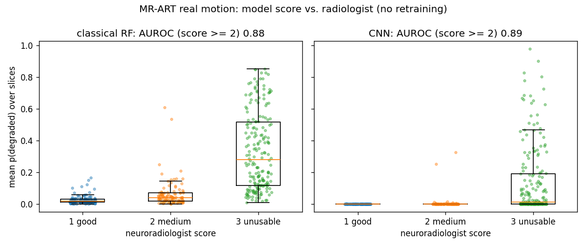

# Automated MRI Image Quality Assessment

Detecting motion, noise and blur in brain MRI with a CNN trained only on
**physics-based simulated artefacts**, then testing it on **real patient
motion** it has never seen.

**📄 Full write-up: [Project report](docs/project_report.md)**, covering method,
results, challenges and future work.

## Results at a glance

| Test | Classical features + random forest | Multi-task CNN |
|---|---|---|
| Simulated artefacts, scanners seen in training (AUROC) | 0.995 | **0.999** |
| Simulated artefacts, unseen scanner (AUROC) | 0.927 | **0.986** |
| Real motion, unseen vendor (AUROC vs. radiologist) | 0.885 | 0.886 |

- The CNN is near perfect on simulated artefacts and generalises to a new
  scanner far better than hand-crafted features.
- On real motion, quality ranking transfers, but the CNN's advantage disappears.
  The likely reason is physical: real motion ghosts run front-to-back, while
  the simulated ones ran left-right.



## Setup

```bash
python -m venv .venv
.venv\Scripts\activate          # Windows  (Linux/macOS: source .venv/bin/activate)
pip install -e ".[dev]"
pip install torch==2.5.1 torchvision==0.20.1 --index-url https://download.pytorch.org/whl/cu118
pytest                          # unit tests on synthetic volumes; no download needed
```

## Running the pipeline

```bash
python scripts/download_ixi.py                       # IXI T1 scans (4.8 GB)
python scripts/explore_ixi.py                        # data checks and subject splits
python scripts/build_dataset.py --workers 6          # simulate artefacts and label slices
python scripts/baseline_classical.py                 # classical baseline
python scripts/pack_slices.py                        # pack slices for fast training
python scripts/train_cnn.py --experiment standard     # CNN (~2.5 h on a laptop GPU)
python scripts/train_cnn.py --experiment unseen_site  # CNN without the GE scanner
python scripts/compare_models.py && python scripts/site_calibration.py
python scripts/download_mrart.py                     # MR-ART real-motion scans (4.5 GB)
python scripts/eval_mrart.py                         # test on real motion
python scripts/make_gradcam.py                       # Grad-CAM heatmaps
python scripts/collect_figures.py                    # copy figures and tables into docs/
```

## Layout

```
src/mriqa/        data loading and preprocessing, artefact simulation, features,
                  baseline, CNN, evaluation, Grad-CAM
scripts/          one script per pipeline step (see above)
tests/            unit tests
docs/             project report, figures and result tables
```

## Data

The datasets are not included (about 9 GB). Both are public:

| Dataset | Used for | Link | Licence |
|---|---|---|---|
| IXI (581 subjects, 3 London hospitals) | Training and simulated-artefact tests | [brain-development.org/ixi-dataset](https://brain-development.org/ixi-dataset/) | CC BY-SA 3.0 |
| MR-ART (148 adults, still and moving scans, radiologist scores) | Real-motion test | [openneuro.org/datasets/ds004173](https://openneuro.org/datasets/ds004173) | CC0 |

MR-ART: Nárai Á. et al., *Sci Data* 9, 630 (2022),
[doi:10.1038/s41597-022-01694-8](https://doi.org/10.1038/s41597-022-01694-8).
Figures showing IXI images are adapted from IXI and shared under CC BY-SA 3.0.
