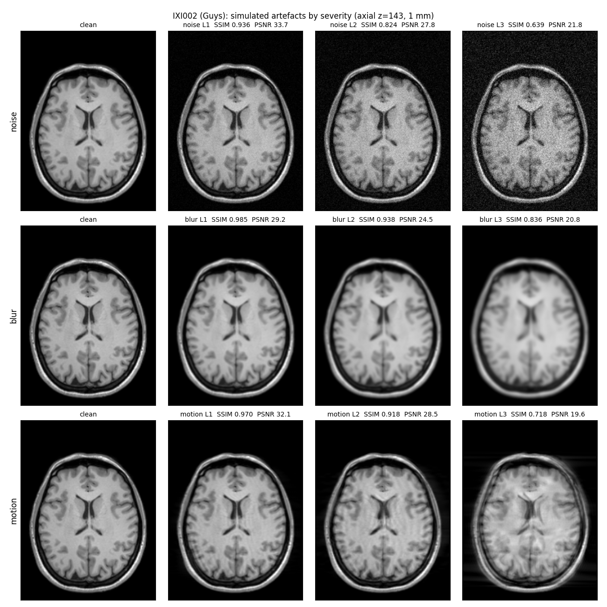
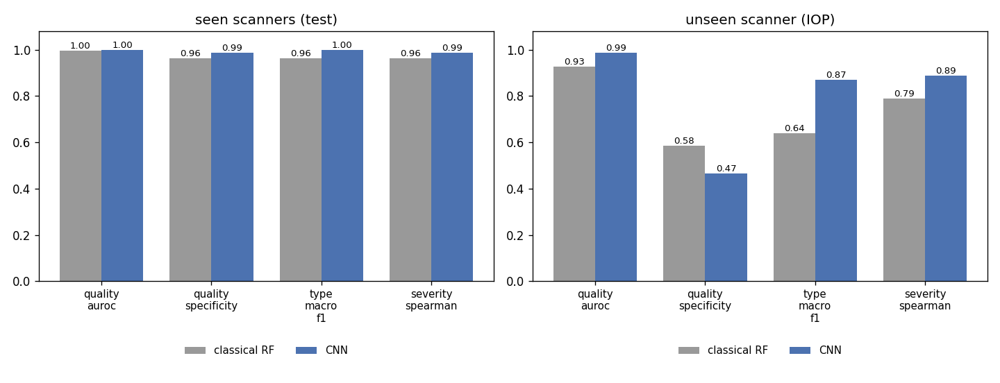
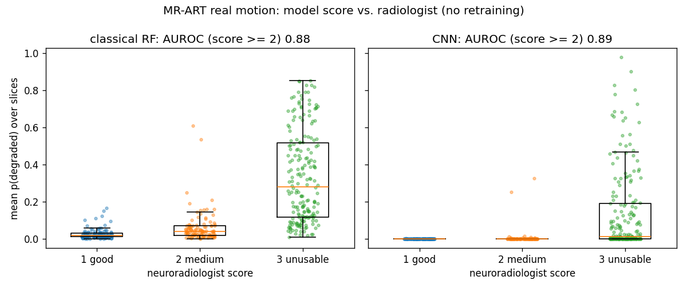
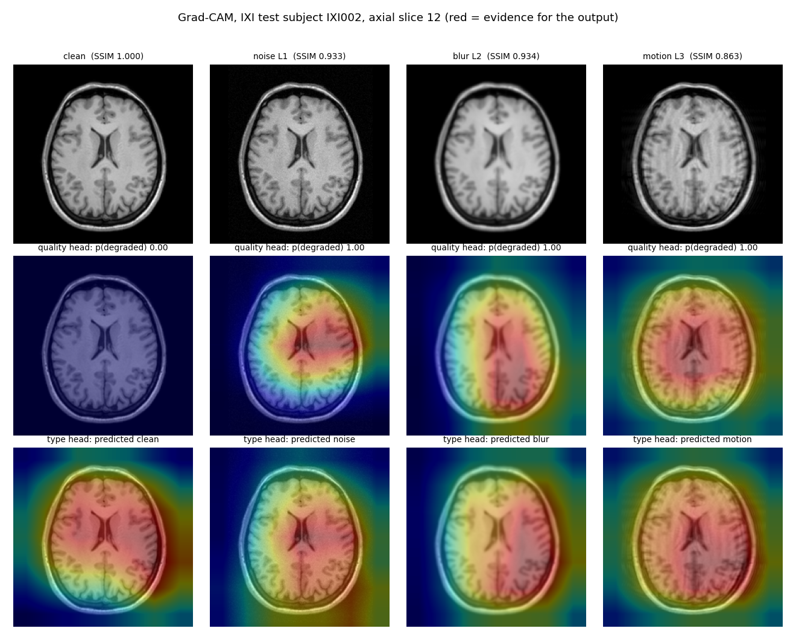
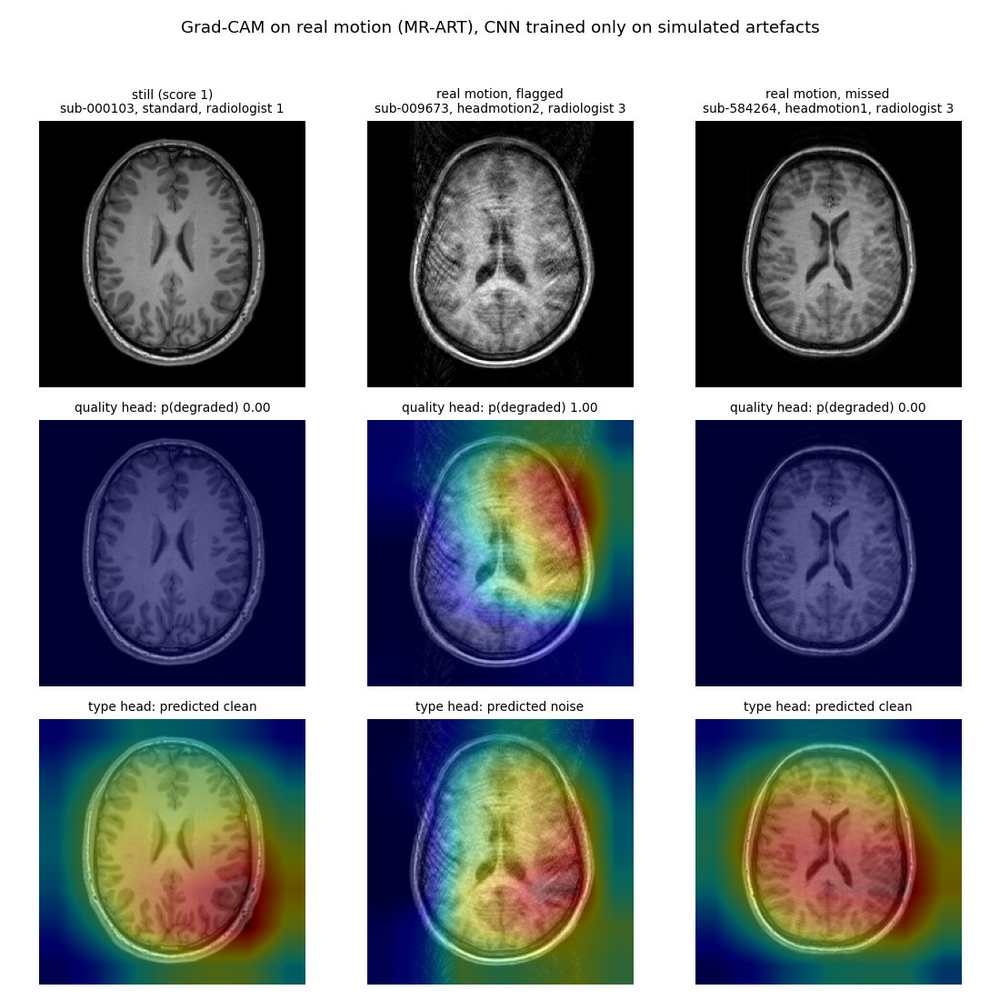

# Automated MRI Image Quality Assessment: Project Report

## 1. Overview

**Problem.** Patient motion, noise and blur can make a brain MRI scan
unusable. If a bad scan is caught while the patient is still in the scanner,
it can be repeated at once instead of requiring a recall visit, and corrupted
images do not go on to mislead radiologists or downstream AI models.

**Question.** Can a CNN trained only on physics-based *simulated* artefacts
detect real artefacts, and does it beat classical image-quality measures?

**Approach.** Simulate noise, blur and motion on clean T1-weighted brain scans
(IXI), train a classical baseline and a multi-task CNN, then test them on
scanners and on real patient motion that were never seen in training (MR-ART).

**Main results**

| Test | Classical features + random forest | Multi-task CNN |
|---|---|---|
| Simulated artefacts, scanners seen in training (AUROC / type F1) | 0.995 / 0.962 | **0.999 / 0.999** |
| Simulated artefacts, unseen scanner (AUROC / type F1) | 0.927 / 0.638 | **0.986 / 0.870** |
| Real motion, unseen vendor (AUROC vs. radiologist) | 0.885 | 0.886 |
| Real motion: a person's 3 scans ordered like the radiologist | 0.949 | **0.974** |
| Real motion called *motion* by the type head | 0 % | 0 % |

1. On simulated data the CNN is near perfect and generalises to an unseen
   scanner far better than hand-crafted features.
2. On a new scanner, both models' probabilities shift; 3 clean scans from that
   scanner are enough to reset the decision threshold.
3. On real motion, quality *ranking* transfers, but the CNN's advantage
   disappears, and neither model beats a standard MRIQC metric.
4. The likely main reason is physical: real motion ghosts run front-to-back
   (anterior-posterior), while the simulated ghosts ran left-right.

## 2. Data

| Dataset | Content | Role |
|---|---|---|
| [IXI](https://brain-development.org/ixi-dataset/) | 581 healthy adults, T1-weighted, 3 London hospitals: Guy's (Philips 1.5 T, 322), Hammersmith (Philips 3 T, 185), Institute of Psychiatry (GE 1.5 T, 74) | Training and simulated-artefact tests |
| [MR-ART](https://openneuro.org/datasets/ds004173) | 148 adults scanned 3 times (still, slight motion, more motion) on a Siemens Prisma 3 T; every scan scored by a neuroradiologist (1 good, 2 medium, 3 unusable) | Real-motion test only |

Splits are by subject (slices of one brain never appear in two splits) and
stratified by hospital: 405 train, 87 validation, 86 test subjects after 3
were excluded because the top of the head was outside the field of view.

## 3. Method

**Preprocessing.** Reorient to a standard orientation (RAS), resample to 1 mm
voxels, mask the head, normalise intensities to the 0.5–99.5th percentiles of
the head. Keep axial slices 20–85 mm below the top of the head (the field of
view includes the neck, so head coverage alone would pick neck and face
slices), every 2nd slice, cut to a fixed 224 × 224 mm window: 33 slices per scan.

**Artefact simulation** (on the whole 3D volume, before slicing, because IXI is
a 3D acquisition):

| Artefact | Model | Level 1 / 2 / 3 |
|---|---|---|
| Noise | Rician (magnitude of signal + complex Gaussian noise), as in real MR magnitude images | σ = 0.02 / 0.04 / 0.08 |
| Blur | Gaussian | σ = 0.6 / 1.0 / 1.6 mm |
| Motion | Rigid head moves during a sequential 3D k-space acquisition; k-space segments acquired after each move come from the moved head | 2 small / 2 medium / 4 large moves, closer to the k-space centre at higher levels |

**Labels.** For each slice: artefact type, nominal level, and SSIM against the
clean slice, computed inside the head only. Three targets: *degraded*
(SSIM < 0.95), *type* (clean / noise / blur / motion) and *severity* (1 − SSIM).
76,296 labelled slices in total.

**Models.**
- *Classical baseline:* 15 no-reference features per slice (sharpness,
  background noise, signal-to-noise, ghosting beside the head, spectral
  anisotropy) and three random forests.
- *CNN:* ResNet-18 with one input channel, trained from scratch, with three
  heads on a shared encoder (degraded, type, severity). Augmentation is limited
  to flips, whole-pixel shifts and contrast changes, so it never adds or
  removes artefacts. 12 epochs on a 4 GB laptop GPU, about 2.5 hours.

**Evaluation.** The same metric code scores both models on: the standard test
split; an *unseen-scanner* split (train on Guy's + Hammersmith, test on every
Institute of Psychiatry subject); and MR-ART, compared with the radiologist's
scores. Grad-CAM heatmaps show where the CNN looks.

## 4. Results

### 4.1 Simulated artefacts and an unseen scanner

| | Seen: RF | Seen: CNN | Unseen scanner: RF | Unseen scanner: CNN |
|---|---|---|---|---|
| Quality AUROC | 0.995 | **0.999** | 0.927 | **0.986** |
| Balanced accuracy (threshold 0.5) | 0.964 | **0.982** | **0.783** | 0.732 |
| Type macro-F1 | 0.962 | **0.999** | 0.638 | **0.870** |
| Severity error (SSIM) | 0.014 | **0.007** | 0.076 | **0.070** |

- On seen scanners, the CNN identifies even the weakest motion in 100 % of
  slices, against 91 % for the baseline.
- On the unseen GE scanner, the classical model calls 92 % of clean slices
  blurred or motion-corrupted: the GE images are naturally smoother, and its
  features measure absolute sharpness. The CNN ranks far better, but its scores
  shift upward, so at the default threshold it flags 38 % of clean slices.
- Setting the threshold from 3 clean scans of the new scanner raises the CNN's
  balanced accuracy from 0.73 to 0.84 (10 scans: 0.87), above the recalibrated
  baseline (0.82 / 0.85).

### 4.2 Real motion (MR-ART)

| Scan-level score | AUROC (any artefact) | AUROC (unusable) | Within-person ordering |
|---|---|---|---|
| CNN | 0.886 | 0.941 | 0.974 |
| Classical RF | 0.885 | 0.942 | 0.949 |
| MRIQC `snr_total` (standard tool) | **0.918** | **0.948** | **0.987** |

| Decision (radiologist score ≥ 2 = artefact) | CNN | RF |
|---|---|---|
| Sensitivity at threshold 0.5 | 0.06 | 0.18 |
| Balanced accuracy, threshold from 3 still scans | 0.75 | 0.75 |
| Balanced accuracy, threshold from 10 still scans | 0.79 | 0.80 |
| Artefact scans typed as *motion* | 0 % | 0 % |

- Ranking transfers: both models put bad scans above good ones and order a
  person's three scans correctly almost every time.
- The CNN is no better than the baseline here, and neither beats MRIQC's
  `snr_total`. Probabilities are badly calibrated: unusable scans average only
  0.14 p(degraded).
- When the CNN does flag real motion, it calls it *noise* 92 % of the time.

**Why: the ghosts run along a different axis.** Motion smears an image along
the k-space axis that is filled slowly over time. A ghost-direction feature
(log ratio of background signal beside the head left-right vs. front-to-back)
has opposite signs:

| | Ghost direction (log L-R / A-P) |
|---|---|
| IXI, simulated motion | **+0.40** (left-right) |
| IXI, clean | +0.06 |
| MR-ART, still | −0.06 |
| MR-ART, unusable | **−1.07** (front-to-back) |

MR-ART's metadata gives the phase-encoding direction as front-to-back, which
for an MPRAGE sequence is most likely the slowly filled axis. The simulator
assumed left-right, a guess forced by IXI not publishing its acquisition order.
Real motion is also continuous rather than a few jumps, and its ghosts are
faint (background signal about 7× below the weakest simulated noise), so the
nearest category the model knows is noise.

### 4.3 Where the CNN looks (Grad-CAM)

| Slices | Evidence inside head | Head area |
|---|---|---|
| Simulated noise | 0.50 | 0.43 |
| Simulated blur | 0.59 | 0.42 |
| Simulated motion | 0.55 | 0.42 |
| Real motion (MR-ART, unusable) | 0.40 | 0.41 |

- For blur and motion the CNN looks mostly at the head, where the damage is.
- For noise, half the evidence is in the background: IXI backgrounds are mostly
  exact zeros, so added noise is easiest to see there. This is a dataset
  shortcut.
- On real motion the evidence is not focused on the head; in the flagged
  example it sits on the front-to-back streaks.

## 5. Challenges

| Challenge | What happened | How it was handled |
|---|---|---|
| Motion labels measured the wrong thing | A move before the k-space centre shifted the whole image, so SSIM measured misalignment (≈ 0.43) instead of artefact | The pose held while the k-space centre is acquired is the reference pose |
| Background dominated the metrics | Most of a slice is air, so whole-slice SSIM mostly scored the background | SSIM and PSNR computed inside the head only |
| Neck and face in the field of view | Selecting slices by head coverage picked neck slices | Slices chosen by distance below the top of the head |
| Overlapping motion levels | Damage depends on *when* the head moves, so nominal levels overlap | Severity target is the measured SSIM, not the nominal level |
| The synthetic task was too easy | The classical baseline already reached AUROC 0.995 | Added an unseen-scanner test and a real-motion test as the real benchmarks |
| Dataset shortcut | Black IXI backgrounds make noise trivial to see | Found with feature analysis and Grad-CAM; documented as a limitation |
| Scanner shift | Scores shift on a new scanner | Per-site threshold calibration from a few clean scans |
| Simulation vs. reality | Real motion was never recognised as motion | Traced to the ghost direction with a feature and Grad-CAM |
| Limited hardware | 4 GB laptop GPU; training slowed 3× on battery and when overheating; 76k slices do not fit in 16 GB RAM | Mixed precision, slices packed into one memory-mapped file, training on mains power with better cooling |
| Unstable training | Validation loss jumped at the learning-rate peak (epochs 3–9) | Best epoch kept; settled to 0.07 once the rate fell |

## 6. Future work

1. **Fix the motion simulation.** Set the slow k-space axis to the
   phase-encoding direction (front-to-back; one parameter, `slow_axis`) and
   simulate continuous nodding (many small rotations about the left-right axis).
   Retrain and re-test on MR-ART. If real motion is then recognised as motion,
   this confirms the explanation above.
2. **Remove the background shortcut:** add realistic background noise to clean
   training scans, or mask the background before the CNN.
3. **Build per-site calibration into the tool** as a set-up step that uses a
   few good scans from each new scanner.
4. **Use real examples:** fine-tune or calibrate with a small number of real
   artefact scans, and measure how few are needed.
5. **Go beyond 2D:** a 3D or 2.5D model would see motion across slices.
6. **Broader data:** clinical scans with pathology, other sequences
   (T2, FLAIR) and other artefacts (bias field, aliasing, spikes).

## 7. Reproducing

Setup and the full sequence of commands are in the [README](../README.md).
Result tables behind the numbers above are in [`results/`](results/).
